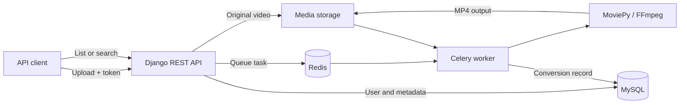

<div align="center">

# 🎬 VideoConvertDJ

### Upload a video. Let the worker handle the conversion.

A Django REST API for asynchronous video-to-MP4 conversion, backed by Celery, Redis, and MySQL.

<p>
  
  
  
  
  
</p>

**[Get started](#getting-started)** · **[API reference](#api-reference)** · **[Try the API](#try-the-api)** · **[Watch the demo](https://drive.google.com/file/d/1DAqYAOkoUejI_oxDAI03klMJONUFRB5D/view)**

</div>

---

VideoConvertDJ separates video uploads from conversion work. The API stores the original file and its metadata, queues a Celery task, and returns a task ID. A worker converts the video with MoviePy and records the MP4 output so the user can list or search completed conversions.

## Features

| 🔐 Accounts | 🎞️ Conversion | 🔎 Discovery |
| --- | --- | --- |
| Sign up and log in | Multipart video uploads | List your completed conversions |
| Password hashing with Django | Background processing with Celery | Search original filenames |
| Custom token-header authentication | MP4 output through MoviePy / FFmpeg | Filter by original file size |
| Logout and token expiration | Original-file metadata storage | Retrieve output media paths |

**API-first workflow:** explore endpoints with Swagger or import the included Postman collection.

## How it works



The upload response confirms that conversion was queued. Check the converted-files endpoint after the worker finishes; there is currently no HTTP task-status endpoint.

## Getting started

### 1. Clone the repository

```bash
git clone https://github.com/Harsh-shah10/VideoConvertDJ.git
cd VideoConvertDJ
```

You need Docker with Compose. The Docker image uses Python 3.10 and installs the pinned packages in [`requirements.txt`](requirements.txt).

### 2. Align the development configuration

The checked-in Django settings contain connection values that differ from the Compose container ports. Before building, update [`projectx/settings.py`](projectx/settings.py):

```python
# Inside DATABASES['default'], keep the existing database/user/password
# and use the Compose service name and internal port:
'HOST': 'mysql',
'PORT': '3306',

# Celery settings:
CELERY_BROKER_URL = 'redis://redis:6379/0'
CELERY_RESULT_BACKEND = 'redis://redis:6379/0'

# Required by collectstatic in the container entrypoint:
STATIC_ROOT = BASE_DIR / 'staticfiles'
```

The `HOST` and `PORT` lines belong inside the existing database dictionary. The Celery and static settings are module-level assignments. Replace the existing Celery values.

> **Configuration note:** Django currently reads these settings directly. Changing only the database and Celery environment values in `docker-compose.yml` does not override the hardcoded settings.

### 3. Build and start

```bash
docker compose up --build -d
docker compose ps
docker compose logs -f web_video
```

The web container's entrypoint runs database migrations, collects static files, starts Celery worker and Beat processes, and launches Django on port 8000. Initial database startup can take a moment.

Open **[Swagger UI](http://localhost:8000/swagger/)** to explore the API. The project provides an API rather than a browser-based video editor.

| Service | From your computer | Inside Compose |
| --- | --- | --- |
| Django API | `localhost:8000` | `web_video:8000` |
| MySQL | `localhost:3307` | `mysql:3306` |
| Redis | `localhost:6380` | `redis:6379` |

Stop services while preserving named volumes:

```bash
docker compose stop
```

<details>
<summary><strong>Development setup notes</strong></summary>

- Compose mounts a named volume over `/app/project-video/`, which includes application code and media. An existing volume can retain older code after an image rebuild; inspect it when updates appear missing. Preserve uploaded files before replacing any volume.
- The entrypoint attempts `service redis-server start`; Redis is actually supplied by the separate Compose service. Its connection URL must use the internal Redis port shown above.
- The checked-in settings use development credentials, `DEBUG=True`, and Django's development server. Deployment requires its own configuration.
- MoviePy delegates video handling to FFmpeg through its dependencies. Input support depends on the available codecs and the file itself; the upload API checks the submitted MIME type for `video`.
- Startup and conversion have not been verified by this README update.

</details>

## API reference

Base URL: `http://localhost:8000`

| Method | Endpoint | Purpose | Token required |
| --- | --- | --- | --- |
| `POST` | `/account/signup/` | Create an account | No |
| `POST` | `/account/login/` | Log in and receive a token | No |
| `GET` | `/account/user_details/` | Fetch the current user's name and email | Yes |
| `PUT` | `/account/upload/` | Upload a video and queue conversion | Yes |
| `GET` | `/account/converted-files/` | List the current user's completed conversions | Yes |
| `GET` | `/account/search/` | Search completed conversions | Yes |
| `POST` | `/account/logout/` | Delete the token supplied in the request body | No header; token in body |

Protected requests use the custom **`token`** header containing the raw login token. Use `token: YOUR_TOKEN`, without a `Bearer` prefix. A new login replaces the user's existing token; stored tokens expire after four hours.

## Try the API

The examples below use a Bash-compatible shell. In Windows PowerShell, use `curl.exe` and adapt quoting as needed, or use Postman.

### Register and log in

```bash
curl -X POST http://localhost:8000/account/signup/ \
  -H 'Content-Type: application/json' \
  -d '{"fullname":"Alex Example","email":"alex@example.com","password":"replace-with-your-password"}'

curl -X POST http://localhost:8000/account/login/ \
  -H 'Content-Type: application/json' \
  -d '{"email":"alex@example.com","password":"replace-with-your-password"}'
```

Copy the `token` value from the login response into the protected requests below.

### Upload a video

```bash
curl -X PUT http://localhost:8000/account/upload/ \
  -H 'token: YOUR_TOKEN' \
  -F 'file=@/path/to/video.avi;type=video/x-msvideo'
```

The multipart field must be named `file`. A successful response has this shape:

```json
{
  "data": "Uploaded Successfully",
  "existingPath": "generated_filename.avi",
  "task_id": "celery-task-id",
  "status": "conversion started"
}
```

### Find completed conversions

```bash
curl http://localhost:8000/account/converted-files/ \
  -H 'token: YOUR_TOKEN'

curl 'http://localhost:8000/account/search/?video_name=example&size=750000' \
  -H 'token: YOUR_TOKEN'
```

`video_name` matches part of the original filename. `size` matches the original file size in bytes. When both filters are supplied, they are combined with **OR**, within the current user's conversions.

Results include a relative `download_link`. Prefix it with the API base URL, and include the `token` header when fetching the media file: the current middleware also checks `/media/` requests.

### Log out

```bash
curl -X POST http://localhost:8000/account/logout/ \
  -H 'Content-Type: application/json' \
  -d '{"logout_token":"YOUR_TOKEN"}'
```

### Postman and Swagger

Import [`videoX.postman_collection.json`](videoX.postman_collection.json), set request URLs to `http://localhost:8000`, and replace sample token values with your login token. Swagger is available at [`/swagger/`](http://localhost:8000/swagger/).

## Project structure

```text
VideoConvertDJ/
├── accounts/
│   ├── middleware.py       Custom token validation
│   ├── models.py           Users, tokens, uploads, metadata, conversions
│   ├── tasks.py            Background MoviePy conversion
│   ├── urls.py             Account and file API routes
│   └── views.py            API request handling
├── projectx/
│   ├── celery.py           Celery application
│   ├── settings.py         Django, MySQL, media, and Celery settings
│   └── urls.py             API, Swagger, and media routing
├── docker/backend/entry-point/
│   └── server-entrypoint.sh
├── media/users/            Original and converted videos
├── docker-compose.yml      Web, MySQL, Redis, and named volumes
├── Dockerfile              Python application image
├── requirements.txt        Pinned Python dependencies
├── sql_queries             Reference SQL schema
└── videoX.postman_collection.json
```

## Development checks

After services start:

```bash
docker compose exec web_video python manage.py check
docker compose exec web_video python manage.py test accounts
```

`accounts/tests.py` is currently a scaffold with no application tests. For a manual smoke check, register, log in, upload a short video, inspect worker logs, and confirm the completed conversion appears in the list and can be downloaded.

---

<div align="center">

**Upload → Queue → Convert → Retrieve**

[Explore the source](https://github.com/Harsh-shah10/VideoConvertDJ) · [Watch the demo](https://drive.google.com/file/d/1DAqYAOkoUejI_oxDAI03klMJONUFRB5D/view)

</div>
